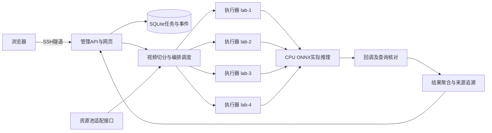

# 车群算力池任务编排调度与协同执行子系统
# 中期软件原型交付物说明

版本：**0.1.0**。交付日期：**2026-09-30**。依据：个人开发计划及《算力共享关键技术研究及原型开发技术要求-9.5》；以2026-11-30中期准备为目标。

## 1 本次交付结论

已完成本人可独立推进的中期软件原型：视频提交 → 实际切分 → 资源约束过滤 → 基础调度 → 指定执行器 → 实际目标检测 → 状态回传 → 完整结果聚合 → 网页展示与历史追溯。系统已部署运行，并提供源码、部署脚本、接口说明、测试证据、操作说明及演示材料。

当前验证使用同一服务器上的4个独立执行器进程。视频处理和推理是真实执行，节点明确标为`server_process`。**本交付属于中期软件部分，不代表真实4车端、正式资源池联合验收或合同全部功能已完成。**

本人负责业务编排、调度、执行协议与结果；资源采集、注册、池化及基础设施由资源池同学主责，座舱域由另一位同学负责。表格逐项分工仍须团队最终确认。

## 2 交付位置与访问

| 项目 | 位置 |
|---|---|
| 服务器 | `ssh -p 22031 root@10.13.0.9` |
| 代码与运行主目录 | `/root/projects/changan-orchestrator` |
| 专用环境 | `/root/miniforge3/envs/changan-orchestrator`，Python 3.11.15 |
| 系统入口 | 建立SSH隧道后访问 <http://127.0.0.1:8310> |
| 在线API文档 | <http://127.0.0.1:8310/docs> |
| 服务器交付包 | `/root/projects/changan-orchestrator/releases/changan-orchestrator-midterm-0.1.0.tar.gz` |
| 校验清单 | 同目录`SHA256SUMS`；包内`CONTENTS.sha256`校验各文件 |
| 本地交付文档 | `/Users/eins/研三上/长安汽车项目/deliverables/中期原型_20260930/` |
| 持续开发记录 | 本地个人开发计划§13；服务器同步副本`docs/开发计划.md` |

电脑端建立隧道：

```bash
ssh -N -L 127.0.0.1:8310:127.0.0.1:8310 -p 22031 root@10.13.0.9
```

源码、环境与测试始终保留在服务器。本地仅同步文档、截图、录屏与验证记录；后续开发继续使用同一服务器目录。系统运行依赖服务器和SSH连接可用。

## 3 软件组成



该图是服务器逻辑部署图，不是实物车端连接图。每个执行器拥有独立状态库、执行ID和HTTP端口，CPU/内存与回环网络仍属于同一物理服务器。正式资源池未配置时，采用执行器真实观测与协调器本地预留；正式适配只做过接口契约测试。

后端采用FastAPI、SQLite WAL、FFmpeg切分与ONNX Runtime；前端采用React。任务、片段、执行尝试、事件、策略、配置与决策均持久化。Redis单机用于能力模板真实读写，主任务状态不依赖Redis缓存。

调度提供可行节点轮询和资源/网络感知两种基础内核，约束包括节点启停、健康、快照时效、执行槽位、内存、模型、架构、标签、位置与指定范围。评分使用已观测吞吐和最近HTTP传输速率，未知指标保留未知/初始估计。优先级影响等待任务顺序，不实现运行中抢占。

异常处理包括幂等提交、目标/实际节点核验、重复和乱序事件过滤、有限重试、截止时限、失联核对、取消、管理服务与执行器重启恢复。执行语义为至少一次加结果幂等；旧执行可能短时继续运行，不能保证即时远端中止或严格一次执行。

## 4 R01—R16阶段对照

“本期软件完成”表示表中描述的软件切片已经实现和验证，不扩大为原条款全部能力完成。

| 编号 / 原文 | 本次实际交付 | 状态和未完成边界 |
|---|---|---|
| R01 / 表1第26项 | 创建、切分、下发、执行、回传、查询、聚合，任务与节点全链路ID | 本期软件完成；真实车端待联调 |
| R02 / 第15项 | 多约束候选过滤、优先级、两种基础算法、失败重选、决策证据及耗时 | 基础版完成；≤10s全局测量口径和真实环境验收待完成 |
| R03 / 第16项 | 截止时限、重试/失败/取消记录、业务完成率和日统计 | 本期统计完成；≥99%调度成功率未验收 |
| R04 / 第27项 | 无鉴权、环境Bearer插件、每次调用重新读取、配置管理与脱敏 | 部分完成；外部认证服务定时刷新未实现 |
| R05 / 第28项 | API GET/POST、键映射、注册/编辑/查询/删除/导出及真实调用 | 本期软件完成；复杂映射和更广协议后续扩展 |
| R06 / 第29项 | 项目独立Redis单机、真实写入读取验证 | 中期单机完成；集群、哨兵和通用连接管理后续 |
| R07 / 第30项 | 未启用Kafka | 按计划后置，不算完成 |
| R08 / 第31项 | 固定能力模板调用内置Python/Shell，记录结果、退出码和超时 | 中期示例完成；任意脚本上传、脚本库管理后续 |
| R09 / 第32项 | 固定视频模板与参数编辑、工作流配置、运行详情、日志 | 中期固定模板完成；完整拖拽DAG、版本管理、任意图执行后续 |
| R10 / 第33项 | API、Redis、脚本、调度算法、平台接口五类固定能力实际运行 | 本期展示完成；通用模板导入和完整节点库后续 |
| R11 / 第34项 | 两个内核的JSON参数注册/上传、选择、输入输出、候选解释、实际落点核验 | 本期基础版完成；任意可执行算法代码上传和完整版本库后续 |
| R12 / 第35项 | 服务/周期策略管理、参数保存、触发实例关联、重启恢复 | 本期软件完成；复杂日历策略和多触发协调后续 |
| R13 / 第36项 | 真实阶段状态、尝试列表、节点时间轴、决策与结果；页面每2秒读取 | 本期软件完成；真车联合监控待联调 |
| R14 / 第37项 | 按时间、工作流、状态、节点查询；事件轨迹及标明“回放”的历史滑块 | 本期软件完成；更复杂日志分析后续 |
| R15 / 第38项 | 调用总览、工作流维度、上海时区日统计、导出与对比 | 中期基础统计完成；不替代合同调度成功率口径 |
| R16 / 表2场景2 | 实际切片、YOLOX检测、片段回传、完整覆盖校验、汇总与识别预览 | 服务器小规模真实业务闭环完成；多真实车端仍待联调 |

完整认证刷新、Kafka、多模式Redis、任意脚本/算法代码插件、通用拖拽编排及应用生命周期平台不在本次已完成范围。中期报告、专利和团队评审属于联合交付事项，本文件可作为本人模块阶段报告材料，不能替代团队签认。

## 5 已验证结果

- 20项单元/API/状态机/契约测试通过；12项真实服务集成检查通过。
- 1个实际浏览器端到端场景通过，包含任务提交至识别结果、决策、导出、回放、能力验证和移动布局；已保存7张截图及流程录屏。
- 同一24秒视频、相同模型和参数，各3次重复基线：单执行器平均12.158秒，四执行器轮询6.321秒，四执行器资源感知7.449秒。三种配置结果一致；本次资源感知未优于轮询。
- 4次注入失败均保留原尝试，再生成新尝试完成聚合；取消任务和无候选超时保持正确终态。
- 环境安装脚本已在现有服务器复跑，模型/素材/Redis源码校验、依赖检查和前端构建通过；尚未做全新机器离线重装。

详见[测试与验证](测试与验证.md)及原始JSON。上述结果不构成真实车端性能承诺。统计为采样帧目标出现次数，不是唯一对象数量；没有识别精度评估。系统保留测试中的失败、取消和超时，不修饰累计完成率。


## 6 交付包清单

| 目录 / 文件 | 用途 |
|---|---|
| `app/` | 管理API、业务模型、持久化、调度、编排、视频处理、连接器和资源池适配 |
| `workers/` | HTTP执行器、持久化状态、目标检测与结果产物 |
| `web/src/`、`web/dist/` | 网页源码及已构建界面 |
| `scripts/` | 安装、启动/停止/重启、素材校验准备、集成及基线测试 |
| `tests/`、`web/e2e/` | 单元、接口、契约及浏览器测试 |
| `.env.example`、`configs/` | 配置示例、独立执行器及systemd参考配置 |
| 环境文件和依赖锁 | Python、Conda及npm的固定版本清单 |
| `assets/manifest.json`、`assets/checksums.json` | 模型及样例素材来源、版本和校验值 |
| `docs/开发计划.md` | 需求范围、原排期、实际完成记录与下一步依赖 |
| `docs/使用说明.md` | 访问、操作、部署、复验及故障排查 |
| `docs/接口与联调说明.md`、`docs/openapi.json` | 已实现接口及与资源池/车端的对接步骤 |
| `docs/测试与验证.md`、`docs/*report*`、`docs/evidence/` | 结论、可复核原始记录及完整任务证据 |
| `docs/演示脚本.md`、`screenshots/`、`recordings/` | 演示顺序、截图及浏览器自动录屏 |
| `docs/第三方组件与素材.md`、`docs/licenses/` | 上游组件和素材记录、分发组件许可证 |
| `CONTENTS.sha256`、`RELEASE.json` | 包内文件校验与版本身份 |

交付包包含源码、构建界面和文档证据；不包含运行数据库、内部令牌、真实`.env`、其他凭据、Conda环境、node_modules或Redis二进制。模型和视频二进制未打包，现有服务器已具备，安装脚本可按来源获取并校验；因此源码包不是完全离线安装包。原始运行数据保留在服务器`data/`。

## 7 运行与维护条件

管理API默认8310、执行器8321—8324、Redis8390，均监听服务器回环地址。默认靠SSH访问；可设置`CHANGAN_API_KEY`保护API并通过网页连接设置建立会话，执行器采用独立内部令牌。原型面向可信开发/演示环境，尚无多租户、完整用户权限体系或公网生产部署方案。

协调器只运行单进程，SQLite用于当前小规模部署；不得直接用多个Uvicorn worker并发运行协调循环。管理脚本核验PID身份后启停本项目服务，不提供进程退出自动拉起。systemd模板仅供部署参考，未安装为开机服务。服务器重启后需按使用说明启动。

运行数据会随视频任务增长，目前不自动删除历史。备份时暂停本项目写入，保存`data/`及私有配置，并单独保护其中令牌；恢复时保持模型、输入及数据目录一致。不要把运行数据库或私有配置混入源码交付包。对外素材和开源组件按项目统一规则复核。

## 8 中期前剩余联调与团队事项

| 下一步 | 需要输入 / 配合 | 本人后续工作与完成证据 |
|---|---|---|
| 单真实车端接入 | 板卡架构、系统、运行时、网络、可部署权限 | 部署执行器或适配加速后端，固定片段真实推理，目标与实际节点一致 |
| 资源池联合接入 | 正式快照、节点身份、原子预留/释放、租约和健康协议 | 替换开发资源适配，测试竞争、失联、恢复及不可用时停止新分配 |
| 扩展4个真实节点 | 4块真实车端、拓扑与校时；管理节点另计 | 四节点在线与资源视图、跨节点分片执行、实物编号和日志一致 |
| 场景与指标冻结 | 最终视频、模型、输出语义、截止时限/成功率分母、全局决策边界 | 更新测试参数并进行真实环境基线、故障与指标统计 |
| 联合中期材料 | 资源池方案、硬件连接图、团队报告/专利/评审分工 | 合并本人源码、接口、部署、结果与演示材料，记录预审及整改 |

上述事项的输入当前尚未提供，不能用服务器进程替代完成。按开发计划在中期前至少两周完成真实环境切换，11月16—22日联合复现与预审，11月30日前准备提交；项目日期冲突由负责人确认。本轮之后继续在开发计划§13更新实测事实。
